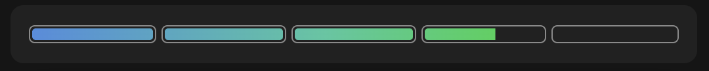

# progress-bar



A Claude Code mod that draws a slim progress bar in the prompt footer, showing Claude's own running estimate of how far along your latest request is. It's made for long requests that run 10 to 40 minutes.

## Install

At the prompt of a Claude Code terminal session:

```
/plugin install progress-bar --marketplace CharlesMod/progress-bar
```

Answer `y` to add the marketplace, then pick a scope (user scope makes it load in every session, the desktop app's local sessions included).

In the desktop app: click **+** next to the prompt box, then **Plugins**, **Add marketplace** with `CharlesMod/progress-bar`, then **Add plugin**.

Requires Claude Code 2.1.299 or newer.

## How it works

- The tags are stripped from Claude's replies as they are drawn and from the saved transcript, so the reader never sees them and later turns don't carry them.
- A short system-prompt section asks Claude to tag each status update with its estimate for the whole request, such as `[D20.9%]` (with a task list, the estimate for the step in progress). The final message ends with `[D100%]`. Quick questions that need no work get no tag.
- The mod reads the last tag in each of Claude's messages and redraws the bar. With no task list, only these tags move the bar, and only forward: a lower estimate than one already shown leaves it where it is. It then removes the tag before the message is saved, so the tag stays out of the transcript and out of Claude's context. No extra tool calls are involved. A tag can flash on screen for a moment while a message streams. Subagents' messages are ignored.
- When three tool calls in a row go by with no estimate, the third one's result carries a one-line reminder to tag the next update, for Claude alone. It comes once per lapse; the next tag starts the count again.
- A new request clears the bar until its first estimate. An interrupted one keeps its last value, marked `· stopped`.
- In the desktop app the bar is a battery-style gauge spanning the band above the prompt. It steps aside while a survey uses that band. Its fill reveals a blue (`#4a8ce0`) to green (`#00dc00`) ramp laid along the whole bar, so the colour follows how far it has got. Change the `ramp` gradient's stops in `hooks/register.tsx` to recolor it.
- Each new estimate eases the fill from where it was to the new estimate, in and out. The bar is drawn as one vector drawing per estimate, which plays once from the moment it appears and freezes where it ends, so nothing in it ever replays or snaps back.
- When the session has a task list (the desktop app's plan, or TodoWrite's list), the bar is cut into one section per step and kept in step with the list. A section fills the moment its step is checked off, and only then: Claude's tag is its estimate for the step in progress, and fills at most 90% of that step's section. A tag in the same response as a check-off counts for the step that check-off starts, since the text arrives before the call. A step that starts with no tag starts empty, and a new plan resets the bar to match it, even if that moves it back. The desktop app's wrap-up checks off the whole list. A section blinks gold with a few sparkles as the fill passes its end; when one move finishes several, they blink one after another.
- When Claude's final `[D100%]` arrives (with a task list, when the last step is checked off, or when the turn ends on a `[D100%]`), the bar turns gold and plays a short visual "ding": a shine passes across, sparkles burst, and a gold border blinks three times. After that the border keeps a soft glow until your next request.
- Remote Control clients (the phone app, claude.ai) and VS Code draw neither the band above the prompt nor the hint line under it. While one is attached, the same text bar is also pinned as the mod's status line, and it's removed when the client leaves.
- In a terminal, a 16-cell block bar that fills in eighths is added to the end of the hint line under the prompt.

Note: a mod's system-prompt hook does not run where an organization manages Claude Code, unless that organization lists the plugin in its managed settings.

## Develop

```
claude plugin validate .
claude plugin test .
```
