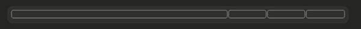

# progress-bar



A Claude Code mod that draws a slim progress bar in the prompt footer, showing Claude's own running estimate of how far along your latest request is. It's made for long requests that run 10 to 40 minutes.

## Install

At the prompt of a Claude Code terminal session:

```
/plugin install progress-bar --marketplace CharlesMod/progress-bar
```

Answer `y` to add the marketplace, then pick a scope (user scope makes it load in every session, the desktop app's local sessions included).

In the desktop app: click **+** next to the prompt box, then **Plugins**, **Add marketplace** with `CharlesMod/progress-bar`, then **Add plugin**.

Requires Claude Code 2.1.299 or newer.

## How it works

- The tags are stripped from Claude's replies as they are drawn and from the saved transcript, so the reader never sees them and later turns don't carry them.
- A short system-prompt section asks Claude to begin each status update with its estimate for the whole request, such as `[D20.9%]` (with a task list, the estimate for the step in progress). Once the work is done, the message that says so opens with `[D100%]` (or the update before a last check carries it), since the bar reads a tag only when its message has finished streaming. Quick questions that need no work get no tag; their bar fills quietly, with no finale.
- The mod reads the last tag in each of Claude's messages and redraws the bar. The bar only moves forward: a lower estimate than one already shown leaves it where it is. It then removes the tag before the message is saved, so the tag stays out of the transcript and out of Claude's context. No extra tool calls are involved. A tag can flash on screen for a moment while a message streams. Subagents' messages are ignored.
- Where the host leaves the mod's system-prompt section out, an ask's first tool call carries the same instructions to Claude alone, so the bar moves in a session with no task list too.
- When you add to a request while it works, or send a message right after stopping it, Claude is told what the bar shows and asked, beside your message and for its eyes alone, for a fresh estimate of where the whole request stands. If its next tag is more than 15 points below the bar, the request has grown and the bar goes back to it. A smaller drop is ignored, so the bar doesn't rewind. A message after stopping carries the request on instead of starting a new one.
- Every tool call that finishes creeps the bar a little forward, at no token cost: a fifth of the way to a ceiling a quarter of the way from what has really been said (Claude's estimate, the learned fill, a command's count) to 90%. So the bar always moves, a little less each time, and is never more than that quarter of the gap ahead of anything real; a real estimate above it takes over. It never moves back.
- The mod learns from your own work, kept across sessions: how many tool calls each finished step took (each finished request of five calls or more, with no task list: quick ones are no guide to long ones). Once it has seen three, each tool call fills the step in progress from that history, held under 85% so only a check-off or Claude's final tag fills it. The history costs no tokens: it never reaches Claude.
- Claude's estimates are read as what they have turned out to mean: each tag is blended with how far through its step's calls Claude was when it gave similar estimates before.
- A command's own count moves the bar too: a `PROGRESS 3/4` marker, a line opening with `N of M`, a test runner's `[ 45%]` at a line's end or a build's `[12/40]` at its start.
- When Claude writes to you mid-request without a tag, the next tool call's result tells it so at once, with what the bar shows. When two tool calls in a row go by with no estimate, the second one's result carries a one-line reminder to tag the next update, for Claude alone. With a task list it says the step in progress's section stays empty until Claude estimates that step. A lapse Claude lets pass is reminded again every fifth call, until the history can fill the bar; a tag, or a step starting, starts the count again. Calls that keep the list don't count.
- A new request clears the bar to empty, and it stays on screen from the start. A quick answer that never gave an estimate fills it, without the finale. An interrupted one keeps its last value, marked `· stopped`.
- A long command can move the bar by its own count, with no estimate from Claude. The bar reads a `PROGRESS 3/4` or `PROGRESS 40%` marker anywhere, or a line that opens with `N of M` (as a CI run's batch lines do). It reads these from the output of Bash, BashOutput, TaskOutput and Monitor, and from a background task's notification, such as a Monitor event. A file read or a search that quotes such a line is ignored. The count moves the step in progress (the whole request, with no list) forward only, and never fills it: a check-off or Claude's `[D100%]` does that. A notification that wakes Claude carries on the same request instead of starting a new bar.
- A move smaller than 3% of the bar keeps the drawing already shown, so small steps don't blink the bar; they add up until the fill has moved far enough to see.
- A new drawing's frame is blank while it loads, so the last drawing stays mounted beneath it and shows through until it has. Only a drawing that carries on from the last one (the same sections, its fill easing on from where that one ended) goes over it; a bar that resets or moves back is drawn alone, so no old fill shows through.
- In the desktop app the bar is a battery-style gauge spanning the band above the prompt. It steps aside while a survey uses that band. Its fill reveals a blue (`#4a8ce0`) to green (`#00dc00`) ramp laid along the whole bar, so the colour follows how far it has got. Change the `ramp` gradient's stops in `hooks/register.tsx` to recolor it. The fill's corners follow the outline's, and while the request works a soft light flows along the fill. While the bar is still empty, a soft blue glow breathes along its middle (with a task list, in the step in progress while its section is empty), fading out before any edge, so it never sits blank; a finished bar is still.
- Each new estimate eases the fill from where it was to the new estimate: a gentle start and a long, soft landing. A drawing never changes once made, so when the app draws the band again (a turn starting or stopping) it keeps its frame and never blanks or replays; when you come back to a session, what had been drawn is shown finished.
- When the session has a task list (the desktop app's plan, TodoWrite's list, or the tasks TaskCreate and TaskUpdate keep), the bar is cut into one section per step and kept in step with the list. The step in progress takes 65% of the bar and the other steps share the rest, so most of the bar is the part that is moving. When a step is checked off, the sections slide to their new widths over half a second, then the fill eases on. A section fills the moment its step is checked off, and only then: Claude's tag is its estimate for the step in progress, and fills at most 90% of that step's section. A tag in the same response as a check-off counts for the step that check-off starts, since the text arrives before the call. A step that starts with no tag starts empty, and a new plan resets the bar to match it, even if that moves it back. The desktop app's wrap-up checks off the whole list. A section blinks gold with a few sparkles as the fill passes its end; when one move finishes several, they blink one after another.
- When Claude's answer ends the request, the bar fills even if its last estimate was lower, and the finale plays. The one exception is a turn that ends to wait on work it left running (a background command or agent, a monitor, a scheduled wake-up): that bar holds until the work wakes Claude again.
- When Claude's final `[D100%]` arrives, the bar turns gold and plays a short visual "ding": a shine passes across, sparkles burst, and a gold border blinks three times. It plays when you see it: when you come back to a session, the bar is simply where the request stands, as if it had all happened in view (no fill moving, sections sliding or steps blinking), and a request that finished while you were away plays only this whole-bar finale. A moment later the whole bar fades out and leaves the band, so the band's pane goes too, until your next request brings it back.
- Remote Control clients (the phone app, claude.ai) and VS Code draw neither the band above the prompt nor the hint line under it. While one is attached, the same text bar is also pinned as the mod's status line, and it's removed when the client leaves.
- In a terminal, a 16-cell block bar that fills in eighths is added to the end of the hint line under the prompt.

Note: a mod's system-prompt hook does not run where an organization manages Claude Code, unless that organization lists the plugin in its managed settings.

## Develop

```
claude plugin validate .
claude plugin test .
python3 sim/build.py
```

`sim/build.py` is the simulator. It drives the real plugin through scripted asks (tags, tool calls, task lists, the learned fill) and writes `sim/out/index.html`, which replays every drawing the band would show, mounted as the desktop app mounts them, and measures each move from the drawing's own SVG clock: eased (with its wait and length), jumped, stuck, or snaps in the app (an animation that begins at 0, which the desktop app shows already finished). Serve `sim/out` over http and open it in a browser that renders it: SVG clocks start only once a page has drawn a frame, and the page says so when it hasn't. Add a scenario to `sim/record.sim.tsx` to check a change before trying it live.
